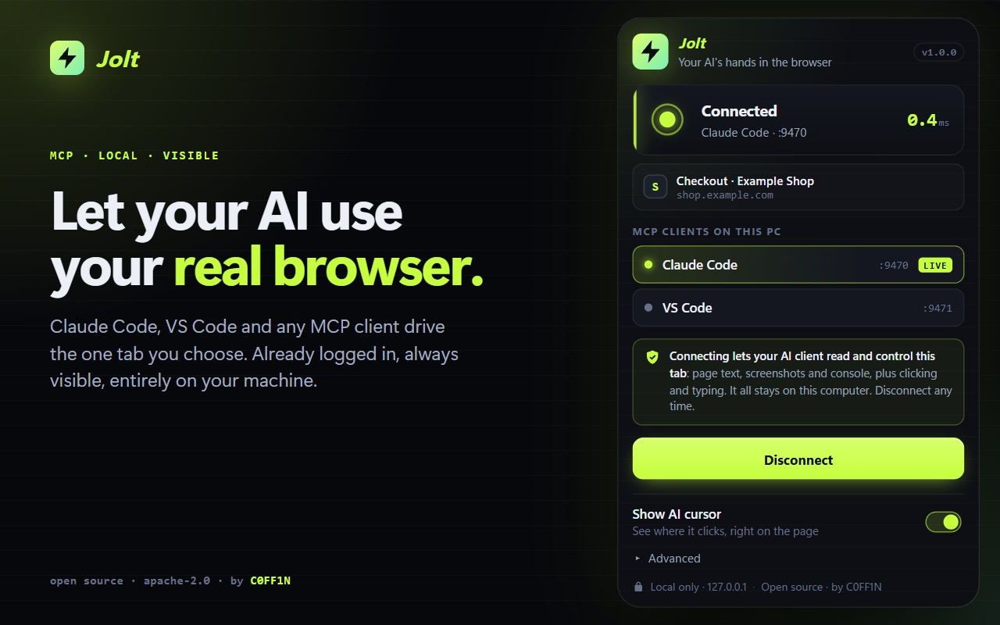

<h1 align="center">Jolt</h1>

<p align="center"><b>Let your AI use your real browser.</b><br>
Claude Code, VS Code and other MCP clients drive the one tab you choose: visible, self-healing, and entirely on your machine.</p>

<p align="center">
  <a href="https://github.com/C0FF1N/jolt/actions/workflows/ci.yml"></a>
  <a href="LICENSE"></a>
  <a href="https://www.npmjs.com/package/jolt-mcp"></a>
</p>

<p align="center"></p>

Jolt is a Chrome extension plus a small local [MCP](https://modelcontextprotocol.io) server. You press **Connect this
tab**; from then on your AI client can read that tab, click, type, take screenshots and read the console, using the
browser session you are already logged into. Nothing leaves your computer except what your own AI client sends.

## Why Jolt

- **Works with several clients at once.** Claude Code and VS Code can run side by side: each gets its own server
  (ports 9470-9480) and the extension finds them all. No ports to type.
- **Heals itself.** Restart a client and Jolt releases the tab (no stuck "debugging" banner), then reconnects on its own,
  typically within about a second. It waits up to 15 minutes and never takes over a server another browser is using. A
  tool call made during a blip waits a few seconds for the reconnect instead of failing.
- **You can see what the AI does.** A cursor glides to every click and hover, with a ripple on click. Toggle it in the
  popup; it adds nothing to the page's text or accessibility snapshot.
- **Lean where it counts.** `browser_batch` runs several actions in one call, any action can skip the post-action
  snapshot, page snapshots are bounded, `browser_wait_for` is event-driven, and a disconnect never hangs a tool call.
  A single ordinary tool call performs about the same as upstream's (differences under ~10% are noise); the gains are in
  the batch and no-snapshot modes. See the [benchmarks](docs/performance-benchmarks.md) and the
  [audit of what was slow](docs/performance-audit.md).
- **Private by design.** Loopback only, one tab at a time, an explicit click to connect, password values never in
  snapshots, no account, no telemetry, no remote code. See [PRIVACY.md](PRIVACY.md) and
  [docs/security.md](docs/security.md).

## Install

You need Node 22+ and Chrome.

**1. The extension.** Install **Jolt** from the Chrome Web Store (search "Jolt: AI browser control"), or load it
unpacked: download `jolt-extension-<version>.zip` from the [latest release](../../releases/latest), unzip it, then
`chrome://extensions` → **Developer mode** → **Load unpacked**.

**2. The server.** Add it to your MCP client:

```bash
# Claude Code (all your projects)
claude mcp add --scope user jolt -- npx -y jolt-mcp

# Claude Code on native Windows needs the cmd /c wrapper for npx servers
claude mcp add --scope user jolt -- cmd /c npx -y jolt-mcp
```

VS Code (`.vscode/mcp.json`, or your user-level `mcp.json`):

```json
{ "servers": { "jolt": { "type": "stdio", "command": "npx", "args": ["-y", "jolt-mcp"] } } }
```

Any other client: command `npx`, arguments `-y jolt-mcp`. Jolt is tested with Claude Code; VS Code and other clients
use their standard MCP stdio configuration, shown above.

**3. Connect.** Open the page you want automated, click the Jolt icon, press **Connect this tab**. Chrome shows its
"started debugging this browser" bar while the tab is linked; that is expected, and it disappears when the tab is
released. Then ask your AI to use the Jolt tools.

Only connect tabs you are willing to expose to your AI client.

## From source

```bash
git clone https://github.com/C0FF1N/jolt.git
cd jolt
corepack enable
pnpm install
pnpm run quickstart   # build everything, then register the server with Claude Code and VS Code
```

`pnpm run setup` does the registration alone (`-- --dry-run` previews; `-- --claude` / `-- --vscode` for one client).
It never overwrites an existing entry unless you pass `--force`, and it backs up VS Code's `mcp.json` first. Then load
`apps/extension/dist` in Chrome (the script prints the path). More: [docs/local-development.md](docs/local-development.md).

## How it works

```text
MCP client ──stdio──> jolt-mcp server ──ws://127.0.0.1:<port>──> Jolt extension ──chrome.debugger──> ONE tab
                           ^                                          │
                           └──────── http://127.0.0.1:<port>/info ────┘   (discovery, ports 9470-9480)
```

Details, measurements and design decisions are in [docs/](docs/):

- [Local development](docs/local-development.md): build, load the extension, configure clients, settings
- [Performance architecture](docs/performance-architecture.md), [audit](docs/performance-audit.md),
  [benchmarks](docs/performance-benchmarks.md)
- [Compatibility with Browser MCP](docs/compatibility.md): tool and protocol compatibility
- [Security model and known limitations](docs/security.md)
- [Releasing](docs/releasing.md)

## Contributing

Issues and pull requests are welcome. Read [CONTRIBUTING.md](CONTRIBUTING.md) first; report vulnerabilities privately as
described in [SECURITY.md](SECURITY.md). Everyone taking part is expected to follow the
[Code of Conduct](CODE_OF_CONDUCT.md).

## Credits and licence

Created by **C0FF1N**. Licensed under [Apache-2.0](LICENSE).

Jolt's server began as a fork of the [Browser MCP](https://github.com/browsermcp/mcp) server (Apache-2.0) and keeps
its tool names and schemas where possible; the Chrome extension is an independent implementation. Jolt is not
affiliated with or endorsed by the Browser MCP project, Anthropic or Microsoft. See [NOTICE](NOTICE) for attribution.
